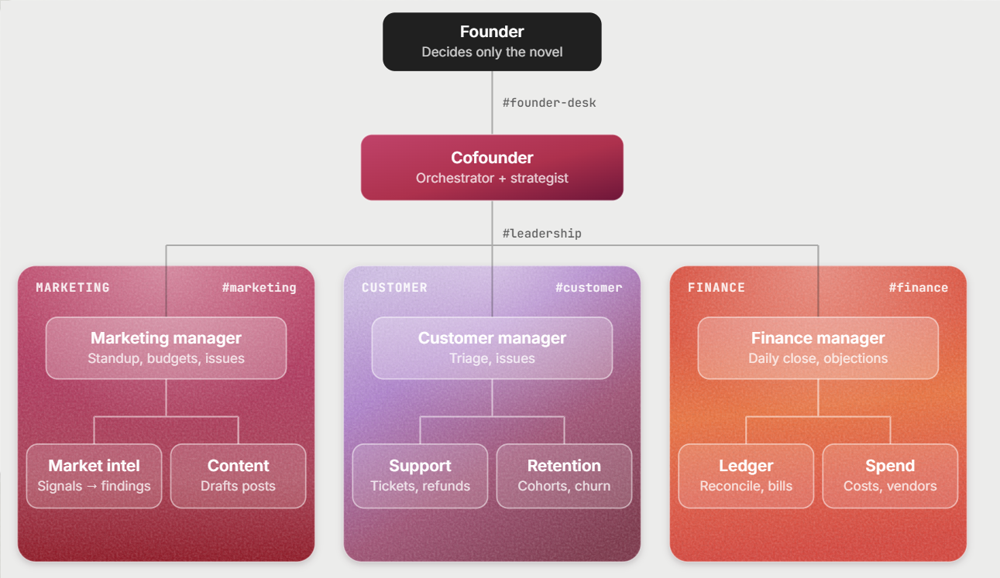

# CoFounder

**AI agents run a one-person company and sort problems out among themselves. They only ask you what no rule covers, and every yes becomes a rule, so they ask less each week.**

Live app: **https://cofounder-chi.vercel.app** · Built solo at Cal Hacks 13.0



## Why

Being a solo founder shouldn't mean being the only employee. Most AI agents today are general-purpose assistants you have to keep prompting, and the ones that work on their own either ask permission for everything (so the company stops when you sleep) or act with no limits at all. CoFounder gives one founder a whole team instead, with limits the founder sets by making decisions.

## What it does

- **A team, not a chatbot.** A Cofounder agent leads three departments, Customer, Finance and Marketing. Each has a manager and two agents, and each department works in its own room.
- **Onboarding sets the routine.** You describe your company once. The Cofounder works out the recurring work and assigns each task to the right room on a schedule.
- **Agents talk to each other.** Every message is typed (assignment, report, handoff, issue, escalation, objection or decision) and validated before anyone acts on it. A dispatcher delivers each message as a new run of the next agent, so whole conversations stay in their threads.
- **Problems climb a ladder.** A double charge goes from Support to the Customer Manager, across to Ledger in Finance, up to the Finance Manager and on to the Cofounder, and reaches you as one decision card with a recommendation.
- **A gate written in code decides.** Agents only propose. Every action is checked against your rules, today's budgets and your past decisions. AI labels actions, but never makes the call.
- **Every yes can become a rule.** "Approve and make it a rule" has Claude draft a rule from your decision, replays it against everything you've decided before, and asks you to approve it. The next time, the agents handle it alone.
- **Real money, real signals.** Refunds are real transfers in Capital One's Nessie sandbox, each one verifiable live from the app. Market Intel works from LinkedIn posts that our Company Radar pulls through Apify.
- **Only one agent can act outside.** The Executor uses Creao's connectors (Linear, Gmail, Google Calendar), and only for actions that passed the gate or your approval.

## How it's built

| Part | What we used |
| --- | --- |
| Agents | 11 [Creao](https://creao.ai) saved agents, started through Creao's API Trigger, one run per step. Setup prompts are in [`agents/creao/`](agents/creao/README.md) |
| Backend | [Convex](https://convex.dev): the gate as one transaction, Workpool per department, Rate Limiter, scheduler and crons, HTTP actions for webhooks, reactive queries for the live app |
| Models | Convex AI Gateway: Claude drafts rules, Jev labels actions |
| Bank | Capital One Nessie sandbox |
| Web signals | Apify (Company Radar) |
| Frontend | React, Vite and Tailwind, hosted on Vercel |
| Agent data access | `co`, a read-only Creao skill in [`skills/co/`](skills/co/SKILL.md) with task-scoped tokens |

The rules that never bend:

1. Agents never execute. Only the backend moves money or calls a connector.
2. The gate is code: one deterministic Convex mutation, no model call inside it.
3. Budgets are spent inside the gate's transaction.
4. Every agent message is validated; an invalid one gets one repair request, then goes to the agent's manager.
5. Keys live only in Convex environment variables.
6. Every state change is written to an audit log.

## Run it locally

```bash
npm install
npx convex dev                 # backend: pushes the schema and functions
npm run dev                    # frontend (in a second terminal)

npx convex run seed:config     # agents and rooms from convex/seed.config.ts
npx convex run nessie:seedNessie   # demo company's bank data in the Nessie sandbox
npm test                       # Vitest + convex-test
```

Backend secrets go in the Convex environment (`npx convex env set NAME value`); the names are listed in [`.env.example`](.env.example). You need a Creao `capi_` account key, a Nessie key, an Apify token, and random strings for the webhook tokens and the `co` token secret.

### Demo mode

With `DEMO_TOOLS=on`, the sidebar's **Demo story** replays recorded agent replies through the real validator, gate, issue ladder, rule learning and Nessie refunds:

1. **Charged twice:** the escalation reaches your desk. Answer with **Approve and make it a rule**, then approve the rule.
2. **Charged twice, next morning:** the same problem, decided by your rule. Nothing reaches you.
3. **Three LinkedIn posts** and **A post after the rule:** a rule learned from three approvals.

`npx convex run story:resetInternal` clears the demo, including its refunds in Nessie. `npx convex run story:primeLive` sends a real double-charge ticket through the live Creao agents instead.

## Repo layout

```
convex/        backend: dispatcher, tasks, gate, issue ladder, rules, Nessie, Apify, Executor
convex/lib/    pure logic with unit tests: envelopes, gate, rules, catalog
src/           founder app (React)
agents/creao/  Creao setup prompt for each agent
skills/co/     the co skill agents use to read company data
assets/        images
tests/         Vitest + convex-test
```

## License

MIT
